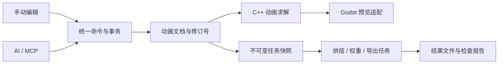

# 木偶人（Puppet）功能设计

2026-10-22 更新：角色绑定现已支持沿网格表面传播的自动蒙皮、权重热图、表面选区、权重修改与手臂影响清除；关节、模型和源动画保持独立。绑定相关 MCP 工具共 20 个，总计 44 个。操作、数据隔离、限制和验证结果见[角色绑定使用说明](角色绑定使用说明.md)。已有模型权重导入、连续涂抹画笔、布料模拟及导出仍待后续开发。

文档版本：1.3。编写日期：2026-10-22。更新日期：2026-10-22。状态：完整产品目标设计；当前已实现范围见《首版使用说明》，其余功能与性能指标继续按阶段验证。

[项目入口](../README.md) · [首版使用说明](首版使用说明.md) · [开发计划](开发计划.md)

确定的技术路线：Godot 4 稳定版 + C++ 动画核心 + GDExtension（原生扩展）+ 独立项目格式 + MCP（模型上下文协议）接口。

软件暂定名为“木偶人”，工程目录名为 Puppet，定位为独立 Windows 桌面动画软件。本项目目录统一承载软件文档、Godot、C++ 与后续接口实现；LxARPG 是首个动画接入验证项目。软件核心独立于 Unreal Engine，制作动画时无需启动 Unreal 编辑器。

本文定义功能、交互、架构、数据及接口约定；分阶段任务、估算、验收、风险与启动清单见《开发计划》。

## 1. 产品目标与版本边界

### 1.1 目标

让用户或 AI 通过操作结构清楚的人形木偶，完成关键姿势、动作过渡、动作库管理、角色适配及选中动画的统一导出。日常制作围绕关键帧开展，软件计算中间姿势；逐帧修改用于局部精修。

完整首版需要覆盖以下结果：

| 编号 | 能力 | 用户最终得到的结果 |
| --- | --- | --- |
| F01 | 木偶关节控制 | 可以旋转关节、拖动手脚、控制根节点和骨盆，并使用可调节的关节限制 |
| F02 | 关键帧动画 | 设置少量关键姿势、时间及曲线后，自动播放完整动作 |
| F03 | 模型绑定 | 无骨骼模型能够经关节定位、骨架生成、自动蒙皮和局部权重修正后播放动作 |
| F04 | 已有骨架适配 | 保留角色原有骨架与权重，通过骨骼映射、姿势校准和重定向复用动作 |
| F05 | AI 接口 | AI 能读取骨架、批量编辑关键帧、设置约束、获取预览、检查结果和导出 |
| F06 | 动作库 | 多个动作可以独立命名、保存、分类、预览和复用 |
| F07 | 批量导出 | 选中角色及动作后，按预设批量输出，并获得逐项结果清单 |
| F08 | 编辑可靠性 | 支持撤销、重做、自动恢复、版本冲突检测和导出前检查 |

### 1.2 首版适用范围

- Windows x64；Godot 小版本、godot-cpp 提交和第三方依赖在 P0 阶段固定。
- 标准双足人形，支持正常比例及适度二次元夸张比例。
- 首先服务待机、行走、跑步、转身、挥剑、格挡、受击和施法等身体动作。
- 导入 GLB/glTF；首版完整交付还包含经过验证的 FBX 导出路线。
- 无骨骼模型以姿态清楚、拓扑正常的人形模型为支持对象；带独立衣服部件时需要分部件检查和权重修正。
- 已有骨架模型首先支持手动映射的人形骨架；自动识别只作为建议，不能覆盖用户确认的配置。
- 首版预览以少量角色为主，重点保证摆姿势、拖动时间轴和播放的流畅性。

### 1.3 后续扩展范围

手指精细动画、表情与口型、四足或多足角色、复杂裙装与头发模拟、肌肉变形、完整物理平衡、多人协作、动捕清理、视频转动作、端到端动作生成模型和其他操作系统，作为后续独立功能。

首版应提供这些功能的扩展入口，但不能把预留入口标为已支持功能。AI 控制接口也不等同于自动获得专业动画质量，需要预览和修改流程。

## 2. 使用流程与核心概念

### 2.1 三个概念分别处理

| 概念 | 解决的问题 | 保存的数据 |
| --- | --- | --- |
| 骨架定位 | 肩、肘、膝等关节在模型中的位置 | 骨骼层级、初始姿势、骨长、局部坐标基准 |
| 蒙皮绑定 | 模型顶点应怎样跟随骨骼变形 | 蒙皮关联、绑定逆矩阵、顶点骨骼索引和权重 |
| 动画重定向 | 木偶动作怎样适配另一套骨架或体型 | 语义映射、骨链映射、参考姿势偏移、比例和接触修正 |

拖动关节只能完成骨架定位。完整绑定需要继续生成或更新蒙皮；已有骨架角色通常使用重定向入口。

### 2.2 制作木偶动画

1. 新建工程，选择标准木偶和关节限制预设。
2. 新建动作，设置时长、编辑帧率和是否循环。
3. 在关键时刻摆姿势，给所选关节或控制器添加关键帧。
4. 播放自动过渡，调整关键帧间距和曲线。
5. 设置脚部接触、手部握持及根运动等要求。
6. 保存到动作库，生成缩略图和简单检查报告。

### 2.3 适配无骨骼模型

1. 导入模型，确认朝向、比例、部件和参考姿势。
2. 在正面、侧面及透视视图中拖动关节定位点，可开启对称编辑。
3. 生成该角色自己的骨架，检查局部轴和骨链。
4. 计算初始蒙皮权重，播放抬手、屈肘、下蹲等诊断姿势。
5. 用分区、锁定和权重画笔修正局部变形。
6. 保存角色配置；为其应用动作库中的动作并预览。

### 2.4 适配已有骨架模型

1. 导入骨架和原有蒙皮，显示原始骨骼层级。
2. 将源木偶的头、骨盆、左右手脚等语义部位映射到目标骨架。
3. 配置手臂、腿和脊柱骨链，校准 A/T 等参考姿势差异。
4. 预览动作，根据体型调整根运动、脚部接触和手部目标。
5. 保存适配配置；角色上的局部动作修正独立保存。

### 2.5 AI 辅助制作

AI 读取软件能力和当前文档 → 生成关键姿势及时间 → 批量提交编辑命令 → 软件求解 → 返回预览拼图与检查数据 → AI 修改指定片段 → 用户审阅 → 保存或导出。

AI 的每组编辑都能作为一项撤销操作。已经授权的普通编辑直接执行，界面提供修改范围、取消和撤销入口；不为每个关节操作新增确认窗口。

## 3. 界面与交互

### 3.1 工作区

| 工作区 | 主要内容 | 主要操作 |
| --- | --- | --- |
| 动作制作 | 木偶、目标角色、时间轴、曲线和控制器 | 摆姿势、添加关键帧、修改节奏和接触约束 |
| 角色适配 | 模型、骨架定位、语义映射、参考姿势 | 定位、生成骨架、校准、重定向预览 |
| 权重修正 | 部件列表、骨骼影响、权重显示和画笔 | 增减权重、平滑、镜像、锁定和归一化 |
| 动作库 | 分类、标签、缩略图和角色预览 | 新建、复制、搜索、多选、批量操作 |
| 导出任务 | 输出预设、动作清单、进度和结果 | 预检、导出、取消和重试失败项 |

### 3.2 主界面布局

- 左上角：木偶人标识、名称与标语；右侧紧贴窗口顶部显示“骨骼动画、角色模型、设置”等大功能。
- 最左侧：以大图标切换“骨架预览、动画制作”等子功能，悬停显示中文名称；底部提供专注视口切换。
- 视口上方：以图标呈现当前子功能的细节工具，包括选择拖拽、旋转关节、观察视角、聚焦和显示选项。
- 视口左侧：骨骼列表、动画库及相关资源操作。当前版本显示只读标准人形层级和按骨架归档的动作。
- 中央：三维视口；支持透视、正面、侧面和顶部视图，显示地面、轴向及米制比例。
- 右侧：所选对象的有效属性；只显示当前模式需要的属性，其他内容折叠到高级选项。
- 视口底部：动画制作面板集中保存、撤销、重做、关键帧与播放控制；自动关键帧和过渡方式放入该面板的更多菜单。后续在此扩展曲线、轨道缩放、平移与区间选择。
- 状态区：当前模式、自动关键帧状态、关节限制提示、后台任务和 AI 操作状态。

布局填满实际窗口尺寸，不按固定比例保留黑边；加宽或加高时优先扩展中央视口。侧栏支持手动收放和窄窗口下自动收起，保留重新打开入口；根位移等属性可折叠，骨架预览时收起动画制作面板。

设置页提供独立的字号与全局界面缩放，保留标题和正文层级，统一影响工具、菜单和时间刻度。偏好即时生效并独立保存，切换设置不改写动画或丢弃临时姿势。较大缩放下工具自动换行、内容允许滚动，顶部设置入口保持可访问。当前实现范围为 12–24 像素字号及 75%–200% 界面缩放，默认 16 像素与 100%。

界面采用中文短名称；API 保留稳定英文标识并提供中文标题、说明和错误消息。木偶采用清晰轮廓、适度概括的木质材质及彩色关节，避免纹理影响结构辨识。

### 3.3 必须明确的编辑状态

- “摆姿势”“编辑参考姿势”“骨架定位”“权重修正”分为独立模式。
- 自动关键帧默认关闭；修改未写入动作时显示“姿势尚未记录”，切换动作前提供保留到姿势库或放弃的明确入口。
- 一次拖拽产生一项撤销记录；拖动过程只刷新临时预览，松开后提交正式命令。
- 旋转越界、目标不可达、未映射骨骼和权重异常直接标记到对应对象。
- 修改角色适配配置不会直接改写共用木偶动作。
- 修改骨架定位后标记相关蒙皮、重定向及导出缓存过期，不能继续使用旧缓存冒充新结果。

## 4. 技术架构与求解流程

### 4.1 模块分工

| 模块 | 技术 | 职责 |
| --- | --- | --- |
| 交互界面 | Godot Control（界面控件）与 GDScript | 面板、时间轴、曲线、选择和用户交互 |
| 预览适配层 | Godot + GDExtension | 创建预览对象，将求解结果应用到 Skeleton3D（三维骨架），更新显示 |
| 动画核心 | 独立 C++ 库 | 骨架、关键帧、插值、FK/IK、关节限制、重定向、蒙皮数据和求解 |
| 文档与命令 | C++ | 项目数据、稳定 ID、修订号、事务、撤销重做和变更通知 |
| 文件适配层 | Godot 适配器及原生格式插件 | 外部文件读取、交换数据转换和导出 |
| 后台任务 | C++ 工作线程；必要时独立辅助进程 | 权重计算、烘焙、导出、预览生成和进度 |
| MCP 适配器 | 独立 Python 服务 | 对外暴露结构化工具，将请求转为软件命令 |

动画核心不包含 Godot 场景节点类型。Godot 的骨架与动画能力可作为显示和播放基础，编辑文档是唯一数据来源，不能让 Godot 轨道与自建曲线成为相互独立的两份真相。[依据：Godot 骨架接口](https://docs.godotengine.org/en/stable/classes/class_skeleton3d.html)、[C++ 扩展](https://docs.godotengine.org/en/stable/tutorials/scripting/cpp/gdextension_cpp_example.html)

### 4.2 数据流



### 4.3 每次采样的求解顺序

1. 根据精确时间码读取源动作关键帧和控制器曲线，生成编辑输入姿势。
2. 计算源骨架 FK（正向运动学）及有效控制空间变换。
3. 求解源骨架 IK、关节限制、脚部固定和握持目标，得到木偶最终姿势。
4. 若启用目标角色，应用参考姿势校准、骨链映射和体型适配。
5. 在目标骨架上执行接触修正、目标角色局部修正及最终约束求解。
6. 输出最终骨骼姿势、根变换及诊断数据，交给视口或导出器。

关节限制应参与 IK 的迭代求解。最后简单裁剪旋转可能破坏接触目标，因此最终检查必须基于约束求解后的姿势。目标不可达时返回实际偏差，不能声称已经满足。

预览和导出调用同一套求解函数；只有采样密度和允许的求解预算可以不同，不能分别实现两套动作语义。

### 4.4 扩展接口

预留骨架模板、约束求解器、自动蒙皮算法、动作处理器、导入器、导出器和检查器等接口。每个扩展声明版本、输入条件、输出和取消支持。首版实现内置扩展注册；对外稳定的原生插件 ABI、脚本市场和热重载留到后续版本，避免在接口尚不稳定时作兼容承诺。

## 5. 坐标、单位、时间与数据精度

### 5.1 空间约定

- 工作空间采用右手坐标系，Y 向上，角色正面为 +Z；与 Godot 的摄像机观察方向通过适配层区分。
- 关节使用自身绑定局部坐标；显式区分“骨骼局部”“骨架空间”“世界空间”。Godot 的骨骼 global pose（整体姿势）是相对于骨架的变换，不直接等于世界变换。[依据：Skeleton3D 说明](https://docs.godotengine.org/en/stable/classes/class_skeleton3d.html)
- 长度统一使用米。用户输入、显示及用户可编辑长度属性保留两位小数；内部单位不切换为厘米。
- 旋转界面使用度，提供弯曲、侧摆和扭转等语义描述；内部姿态以四元数计算。每个骨骼的局部轴、正向及参考零位必须可查询。
- Godot、glTF 和 UE 之间的坐标、朝向、手性和单位差异集中在格式适配器处理，避免重复转换。

### 5.2 两位小数与精确采样

用户可编辑的时间输入和显示统一为秒，保留两位小数。软件不得将每一帧间隔反复舍入到 0.01 秒后累加；这会改变 30/60 FPS 动画的实际时长。

采用以下表示兼顾编辑规范和采样：

- 用户通过秒数设置关键帧时，录入值按两位小数处理。
- 时间轴、关键帧身份和采样定位使用 `TimeCode`（时间码）：整数刻度及每秒刻度数。首版每秒 60000 刻度，可精确表示 24、30 和 60 FPS 的采样位置。
- API 提供互斥的“秒数定位”和“样本索引 + 帧率定位”；秒数输入遵守两位小数，按帧操作保持精确索引。
- 时间码是秒的精确整数表示，不引入毫秒等用户时间单位。按帧创建的关键帧另显示帧号，避免两个不同关键帧只因秒数显示舍入而看似重合。
- 插值因子、四元数、矩阵、蒙皮权重和导出的派生采样数据不按两位小数截断。源网格和导入参考姿势保留原始数据精度；用户主动编辑的长度才使用米制两位小数。

### 5.3 关键数据对象

| 对象 | 中文职责 | 必须包含的信息 |
| --- | --- | --- |
| ProjectDocument | 工程文档 | 格式版本、工程 ID、修订号、单位和坐标约定、资源索引 |
| RigDefinition | 骨架定义 | 骨骼稳定 ID、父子关系、语义部位、参考姿势、对称关系 |
| JointLimitProfile | 关节限制配置 | 轴定义、限制形状、活动范围、严格或宽松模式 |
| AnimationClip | 动作片段 | 动作 ID、源骨架 ID、时长、轨道、循环方式、根运动和标签 |
| AnimationTrack | 动画轨道 | 目标 ID、属性、关键帧、插值类型和切线 |
| ConstraintTrack | 约束轨道 | 接触目标、激活区间、权重曲线、求解优先级及控制空间 |
| CharacterBinding | 角色绑定 | 模型资源、目标骨架、蒙皮和角色原始姿势 |
| RetargetProfile | 动作适配配置 | 源/目标骨架版本、语义映射、骨链、姿势校准及比例策略 |
| CharacterClipOverride | 角色动作修正 | 指定角色与动作的局部修正，保留源动作引用 |
| ExportPreset | 导出预设 | 格式、骨架策略、采样率、坐标转换、根运动和命名规则 |
| JobRecord | 后台任务 | 任务 ID、输入快照修订号、状态、进度、结果和错误 |

重命名资源不能改变稳定 ID。骨架拓扑或参考姿势变更递增骨架版本；文档修改递增文档修订号。缓存和导出任务必须记录它们所使用的版本。

## 6. 木偶关节控制设计

### 6.1 标准木偶

首版默认骨架包含 23 个主要节点：根节点、骨盆、下脊柱、上脊柱、胸部、颈和头；左右各一组锁骨、上臂、前臂和手；左右各一组大腿、小腿、脚和脚趾。手指及额外扭转骨由扩展模板提供。

- 根节点负责整体位移和转向；骨盆负责身体重心及姿态，两者分离。
- 关节用球体或清楚的连接件表现，骨段用木质体块表现；显示左右侧、旋转轴和选择轮廓。
- 支持关节显示、木偶外形显示、透视骨骼、地面接触点和目标角色叠加。
- 模板体型调整与动画姿势调整分离。改变骨长会生成新的骨架版本，不能悄悄修改已有动作的参考骨架。

### 6.2 控制方式

| 功能 | 操作 | 结果与边界 |
| --- | --- | --- |
| FK 旋转 | 拖动旋转环或输入语义角度 | 修改所选关节，子骨骼随层级运动 |
| 手脚 IK | 拖动位置和朝向目标 | 自动求解手臂或腿部，保留关节限制 |
| 肘膝方向 | 拖动方向控制点 | 避免肘膝在接近伸直时突然翻转 |
| 骨盆控制 | 平移、旋转骨盆 | 支撑脚可保持接触，允许检查不可达情况 |
| 接触固定 | 给手或脚设置激活区间 | 在区间内保持世界、角色或道具空间的目标 |
| 对称编辑 | 同时修改左右部位 | 按参考平面和局部坐标正确镜像 |
| 姿势操作 | 复制、粘贴、镜像和复位 | 可作用于全身或选中部位 |

首版优先完成双骨段 IK、稳定的肘膝方向和脚部固定；全身平衡求解作为后续增强。

### 6.3 关节限制

- 提供自然、宽松和自定义预设，允许角色或动作覆盖默认配置。
- 膝、肘等使用主要弯曲轴；肩、髋等使用摆动锥与扭转限制；脊柱按多段骨链分配旋转。
- 限制描述以实际定义的局部轴为准，不能把一个通用的 XYZ 角度范围视为所有关节的真实人体限制。
- 支持严格约束和提示模式。严格约束将目标投影到允许区域；提示模式保留输入但标记越界。
- 写入或求解后返回请求值、实际值、是否受限及受限原因。
- 人体参数是创作预设，不宣称医学级关节模拟，也不自动保证平衡、无穿插或动作自然。

### 6.4 控制空间与切换

手脚目标支持世界空间、角色空间和道具空间。切换 FK/IK 或控制空间时，先匹配当前姿势，再切换控制权，避免跳变。首版至少提供无跳变的显式切换；连续动画切换和可动画的混合权重在后续迭代增强。

## 7. 关键帧、过渡与动作库

### 7.1 关键帧编辑

- 支持关节旋转、根节点和骨盆位置、IK 目标、约束权重等轨道。
- 添加、删除、移动、复制、粘贴和区间缩放关键帧；支持全身、所选骨链和单属性写入。
- 不同关节允许使用不同的关键帧时刻；例如骨盆先转、胸部随后、手臂再跟进。
- 新增关键帧可以记录当前值，也可由调用方提供明确值；写入同轨道同时间点时按显式的替换或拒绝策略处理。
- 稀疏轨道未记录的属性使用骨架参考值或片段基准姿势，不继承上一段动作遗留的预览状态。
- 首版保存稀疏关键帧；逐帧烘焙是可选处理或导出步骤，不是编辑前提。

### 7.2 插值与曲线

| 类型 | 用途 | 实现约定 |
| --- | --- | --- |
| 保持 | 检查关键姿势与节奏、分段跳变 | 到下一个关键时刻才切换值 |
| 线性 | 简单连续过渡 | 标量和位置线性变化；旋转使用四元数球面插值 |
| 平滑 | 常规姿势过渡 | 首版使用可调整的缓入缓出时间函数；位置和标量支持三次曲线 |
| 自定义切线 | 精修起止速度和动作节奏 | 曲线编辑器允许分别调整进入、离开切线；旋转曲线使用与四元数语义一致的表示 |

平滑插值需要检查过冲。四元数归一化、同向符号处理及跨角度边界必须统一；不能直接把独立 XYZ 欧拉角的线性变化当作所有旋转的正确过渡。首版对超过一圈的连续旋转要求插入中间关键姿势，避免最短路径插值消除用户意图。

### 7.3 循环与根运动

- 动作显式选择非循环或循环；循环检查姿势衔接，并提示速度衔接异常。
- 循环播放使用半开区间，播放到片段末尾时回到起点；导出是否保留重复端点由格式预设决定。
- 根运动模式分为“保留位移”和“原地动作”。原地化只按预设移除指定平移或朝向分量，不能把骨盆起伏一起消掉。
- 同一个动作可以按不同预设导出，源动作保持原始根运动。
- 帧率用于编辑步进和输出采样；修改输出帧率不改变秒制时长和动作速度。

### 7.4 动作辅助

首版提供多视角预览、前后姿势残影、轨迹显示、左右镜像、姿势库和慢速播放。简单动作可先用少量关键姿势形成草稿，再局部补帧。

示例横斩：0.00 秒站姿、0.20 秒蓄力、0.30 秒命中、0.50 秒随挥、0.80 秒恢复。示例只说明工作方式，不能作为所有角色的固定动作模板。

### 7.5 动作库

- 每个片段保存名称、分类、标签、缩略图、时长、循环、源骨架和作者备注。
- 支持搜索、排序、复制、重命名、多选和批量标签操作。
- 缩略图与预览缓存可重建，不是动作唯一数据来源。
- 姿势库与动作库分开：姿势保存单时刻配置，动作保存时间序列。
- 角色适配配置和角色动作修正通过 ID 引用源片段，不把每个角色的所有动作复制成难以维护的独立工程。
- 修改源动作后标记相关角色预览过期，重新求解；已有导出结果记录旧修订号，不能自动冒充最新结果。

## 8. 模型绑定、权重与重定向

### 8.1 导入和预检

导入器应在打包后的应用中工作，不能依赖 Godot 编辑器先扫描工程目录。首版优先使用运行时 GLB/glTF 入口；FBX 输入在 P0 验证其目标版本和打包结果后加入支持清单。[依据：Godot 运行时文件加载](https://docs.godotengine.org/en/stable/tutorials/io/runtime_file_loading_and_saving.html)

导入后显示模型高度、轴向、部件、骨骼、权重和贴图概况，检查无效数值、零尺度、负尺度、骨架循环、缺失贴图、空网格和异常骨骼关联。发现不能直接处理的缩放或变换时，提供明确的规范化操作及结果预览。

参考姿势需手脚部位可辨识，允许 A/T 姿势。姿势不合适时提示校正需求；算法不默默重新摆放模型顶点。

### 8.2 无骨骼模型：定位与骨架生成

- 提供标准关节点清单，至少定位骨盆、肩、肘、腕、髋、膝、踝及脚趾方向。
- 正面定位横向与高度，侧面定位深度；支持透视查看、对称联动和独立微调。
- 关节定位点通常位于模型内部。表面吸附只能辅助定位，不能把表面点直接当成关节旋转中心。
- 根据点位生成独立角色骨架，检查骨长、父子关系、左右侧、骨链方向和零长度骨骼。
- 参考姿势确认后生成绑定数据，保留原模型及前一个绑定版本。
- 调整点位时标记蒙皮需要重新计算；明确区分“只移动显示控制器”和“修改真实骨架参考姿势”。

### 8.3 无骨骼模型：自动蒙皮

首版原生算法采用骨段距离、部位分区、连通部件约束及平滑生成初始权重，优先保证可解释和可修正。薄层衣物、相邻肢体、裙摆或手贴身体等情况可能需要人工分区。更高级的热扩散或体素算法作为后续替换插件。

必须提供以下结果检查：

- 每个参与蒙皮的顶点至少有一个有效影响，权重非负且归一化。
- 默认最多保留 4 个骨骼影响；导入或特定预设需要更多影响时保留原数据，导出阶段显式转换并报告误差。
- 非变形控制骨不参与自动权重分配。
- 身体、衣服和附件可以分别设置参与区域与权重策略；武器等刚性附件支持刚性绑定。
- 极端拓扑、非流形和异常重叠时返回具体部件与原因，不输出假成功。

自动算法只提供初始结果，首版完成标准包括后续人工修正能力和诊断姿势检查。

### 8.4 权重修正

提供骨骼影响颜色显示、顶点/区域选择、增加、减少、设定、平滑、镜像和锁定影响。每次笔画是一项撤销操作；归一化只调整未锁定部分，出现锁定总和不合法时返回提示。

诊断姿势至少包含举手、屈肘、抬腿、下蹲和转体；并排比较参考姿势与变形结果。检查肩、肘、胯和膝等部位；查看无权重点、权重串到另一条肢体和明显塌陷。

### 8.5 已有骨架模型：映射与校准

- 原有骨架、命名、层级和蒙皮默认保持原样；源木偶骨架不替换目标骨架。
- 自动候选匹配参考名称和空间位置，用户可手动指定并锁定。
- 必需映射包括骨盆、头、手臂和腿；脚趾、额外脊柱、扭转骨及手指声明为可选能力。
- 骨链支持源与目标骨骼数量不同；额外扭转骨可按权重分配旋转，未支持的附加骨保留参考姿势或原有驱动并提示。
- 校准源/目标参考姿势和局部轴差异；已有骨架的校准保存为适配偏移，避免改写蒙皮所依赖的原绑定姿势。
- 目标不具备必需骨链、存在循环或无法解析的变换时，拒绝启用该配置，并列出未满足项。

参考姿势校准和骨链映射是重定向配置的一部分；不同骨骼数目的人形复用可参考 UE 官方的骨链重定向说明。[依据：Epic IK 重定向](https://dev.epicgames.com/documentation/en-us/unreal-engine/ik-rig-animation-retargeting-in-unreal-engine)

### 8.6 体型适配与接触修正

- 根位移按角色比例或用户指定比例处理，骨盆高度与腿长配合调整。
- 手脚接触点在目标角色上重新求解，不简单复制源关节世界坐标。
- 脚部接触使用显式区间；自动检测可以提供候选，但由动作配置确定最终区间。
- 双手握持时指定主手、辅助手和道具上的握持点，避免循环依赖；道具轨迹由主控制器或独立轨道驱动。
- 头、躯干和肩等部位可使用不同的重定向权重。
- 骨链太短、接触目标不可达时显示偏差，允许调整动作或降低约束权重；不默认拉长骨骼。
- 角色特有修改保存到 CharacterClipOverride（角色动作修正），共用源动作继续可复用。

## 9. AI 接口与编辑命令

### 9.1 接入方式

外部客户端通过 MCP stdio（标准输入输出）连接独立 Python 适配器；适配器通过本机 IPC 连接已运行的软件实例。当前实现使用 Godot 原生 TCPServer 监听 `127.0.0.1` 的动态端口，并通过每实例随机令牌验证连接；内部通道可以替换，不改变对外工具语义。

MCP 的标准传输与软件内部 IPC 分开。stdio 输出只发送协议消息，日志写入标准错误输出；不把普通 WebSocket 描述为 MCP 的标准传输。[依据：MCP 传输规范](https://modelcontextprotocol.io/specification/2025-11-25/basic/transports)

AI 是可选客户端，软件本身的手动制作、保存和导出不依赖模型服务或网络。首版不内置对某个模型供应商的依赖；后续可增加软件内对话入口。

连接握手返回实例 ID、当前打开文档清单及能力版本。后续读写显式指定文档，避免多个软件实例或多个工程之间发生目标混淆。

### 9.2 对外工具清单

下表为完整产品规划，当前实现以 `mcp_service/tool_catalog.py` 和 `get_capabilities` 为准。已交付的 44 个工具及准确参数见 [MCP 使用说明](MCP使用说明.md)。动画保存工具为 `save_clip`，角色项目使用 `save_binding_project`；暂不提供工程另存、导出或后台任务工具。

| 工具 | 中文名称 | 必要输入 | 主要输出 | 首次交付 |
| --- | --- | --- | --- | --- |
| get_capabilities | 读取软件能力 | 协议版本 | 已实现功能、工具版本、限制、可用格式 | P3 |
| get_document | 读取工程摘要 | 工程或实例 ID | 修订号、动作、角色和当前选择 | P3 |
| get_rig | 读取骨架 | 骨架 ID | 层级、轴、参考姿势、限制和语义部位 | P3 |
| create_clip | 新建动作 | 名称、骨架、时长和循环设置 | 动作 ID、文档修订号 | P3 |
| evaluate_pose | 计算指定姿势 | 动作、角色、时间定位 | 实际局部/整体姿势、根变换和诊断 | P3 |
| apply_edit_batch | 批量编辑 | 基础修订号、请求 ID、编辑命令列表 | 新修订号、实际写入值、受限或失败原因 | P3 |
| render_preview | 生成预览 | 动作、角色、时刻、视角及分辨率 | 任务 ID 或图像及对应时间标记 | P3 |
| validate_clip | 检查动作 | 动作、角色和检查预设 | 问题时间、部位、严重程度和测量值 | P3，逐阶段扩展 |
| save_project | 保存工程 | 工程 ID、目标位置或现有保存路径 | 保存版本及结果 | P3 |
| undo_edit / redo_edit | 撤销 / 重做编辑 | 预期修订号、指定事务 ID | 当前修订号及执行结果 | P3 |
| get_retarget_profile | 读取适配配置 | 配置 ID | 映射、参考姿势偏移和缺失项 | P4 |
| update_retarget_profile | 修改适配配置 | 预期修订号及配置差异 | 新版本、检查结果 | P4 |
| create_binding | 创建角色绑定 | 模型、模板、定位点和模式 | 绑定草稿 ID、缺失项 | P5 |
| generate_skin_weights | 生成蒙皮权重 | 绑定版本、算法和区域约束 | 后台任务 ID | P5 |
| export_batch | 批量导出 | 明确的角色/动作组合、预设和目录 | 任务 ID、计划输出清单 | P6 |
| get_job / cancel_job | 查询 / 取消任务 | 任务 ID | 状态、进度、结果或取消确认 | P3，覆盖逐阶段新增任务 |

能力清单只暴露已实现的功能。MCP 工具可声明结构化输入输出并返回图像内容，适合同时提供姿势数据和预览。[依据：MCP 工具规范](https://modelcontextprotocol.io/specification/2025-11-25/server/tools)

### 9.3 编辑命令

`apply_edit_batch`（批量编辑）的首批命令包括设置关节姿势、插入/删除关键帧、移动关键帧区间、修改曲线、创建/调整接触约束、设置 IK 目标、设置根运动模式及修改动作元数据。修改关键帧和修改临时预览姿势使用不同命令，避免 AI 误以为预览改变已经写入动画。

当前已交付命令为 `set_duration`、`set_clip_options`、`upsert_keyframe`、`delete_keyframe`、`move_keyframe` 和 `solve_ik`。设置时长支持保留关键帧时刻或整体缩放，缩短时不静默删除关键帧；关节输入通过稳定 ID 定位，部分姿势按候选动画在该时刻的采样结果补齐。新骨架通过完整定义注册，调整参考层级与骨长必须使用新的骨架 ID；约束通过 `update_joint_limits` 单独修改并递增修订。

P4、P5 逐步加入骨骼映射、参考姿势校准、定位点、区域和权重修改命令；通过能力清单声明支持的命令版本。

一次批量编辑先校验后提交，任何命令失败则整组不提交。约束投影属于显式选择的策略，返回请求值和实际值；格式错误、目标缺失和修订冲突不能用裁剪方式掩盖。

### 9.4 请求与结果约定

| 字段 | 中文意义 | 约定 |
| --- | --- | --- |
| api_version | 接口版本 | 大版本不兼容时拒绝调用，避免静默误解释 |
| project_id / document_id | 工程 / 文档 ID | 不依赖当前界面焦点识别写入目标 |
| expected_revision | 预期修订号 | 写入前核对，冲突时返回最新版本并要求重新读取 |
| request_id | 请求唯一编号 | 重试相同请求不重复创建动作或重复应用旋转 |
| target_id | 稳定对象 ID | 引用骨骼、轨道、角色或动作，重命名后仍有效 |
| time_seconds | 秒数定位 | 仅接受两位小数范围；与样本定位互斥 |
| sample_index / sample_rate | 样本索引 / 采样率 | 精确按帧定位，转换到内部时间码 |
| transform_space | 变换空间 | 明确为局部、骨架或世界，不使用不明含义的 global |
| limit_policy | 关节限制策略 | 拒绝、投影或提示，由请求或预设明确选择 |
| actual_values | 实际执行结果 | 返回最终应用的姿势或关键帧值及受限状态 |
| transaction_id | 事务 ID | 关联一组修改与撤销记录 |
| job_id | 后台任务 ID | 对生成预览、权重和导出等长任务进行查询或取消 |

旋转支持语义关节角度或四元数输入，必须注明相对于参考姿势的增量还是骨骼局部姿态。单位和骨架轴信息通过 `get_rig` 返回，不能依靠 AI 猜测。

当前写入接受相对参考姿势的 XYZ 欧拉角，回读同时提供角度与四元数，参考旋转使用 XYZW 四元数。实际局部旋转为 `rest_rotation * Rz(z) * Ry(y) * Rx(x)`，骨架空间为 +Y 向上、+Z 向前。内部求解和截图都使用同一份骨架定义与原生核心。约束模型目前为 `euler_xyz`，后续新增模型通过能力清单声明，不假定所有关节均为三自由度。

### 9.5 并发、取消和数据一致性

- 手动编辑与 AI 编辑进入同一命令队列；写入按文档修订号串行提交。
- 请求唯一编号关联请求内容摘要；同编号不同内容返回错误。完成结果在当前工程会话内可查询，避免网络重试重复执行。
- 查询指定快照可以与编辑并行；导出和权重计算必须固定输入快照。
- 后台权重结果回写前检查绑定版本。用户已调整骨架时，把旧结果标记为过期并保留为可查看结果，不覆盖新配置。
- AI 只能撤销明确指定且仍位于可撤销位置的事务；人工插入了新编辑时返回冲突，不能盲目撤销用户操作。
- 取消是显式操作；连接断开不等于自动撤销已经成功的编辑。
- 运行中的长任务支持协作取消；已写完并通过检查的导出文件与未完成项分别记录。

### 9.6 预览与诊断反馈

预览优先生成正面、侧面和斜侧面的连续帧拼图，每张图显示动作 ID、角色、修订号和时刻。返回图像及摘要，详细姿势按需分页查询，不默认向模型返回整段所有顶点数据。

当前 `render_preview` 返回至多 12 张独立 PNG，支持正、背、左、右、顶及透视/自定义视角，可按关节 ID 取景。每张图片随附时刻、摄像机、骨架约束版本和关节像素投影，整个响应带文档快照修订及动作修订。截图使用独立三维世界，保留用户编辑器的角度、当前时间、选中关节与草稿；无图形模式明确返回无法渲染，不返回伪造图片。`get_view/set_view` 用于直接观察编辑视口。

诊断结果包括关节越界、IK 目标偏差、脚部接触偏移、地面穿透、循环接缝和异常数值。完整自碰撞与服装碰撞另行实现；首版胶囊体检查属于近似检测，报告应注明方法。

软件显示 AI 编辑的对象、时间范围及结果，支持取消和撤销。普通编辑按授权执行；覆盖既有文件由预设明确规定，默认使用新名称保留旧文件。

## 10. 批量导出与 UE 接入

### 10.1 输出形式

| 输出 | 用途 | 首版约定 |
| --- | --- | --- |
| 可编辑项目目录 | 继续制作和完整保存 | 保存源动作、绑定、权重、约束和适配配置 |
| GLB/glTF | 开放的角色与动画交换 | 支持骨架、蒙皮、动画；控制器和约束求解后转为骨骼动画 |
| FBX | 面向 UE 和其他 DCC 的动画交付 | 原生导出适配器；按已验证的版本和预设输出 |
| 结果清单 JSON | 批处理复查和自动接入 | 记录文件、角色、动作、快照修订号、参数、错误与摘要 |
| 事件清单 JSON | 保存脚步、命中等语义时间标记 | 单独输出，不宣称通用交换格式会自动生成 UE 动画通知 |

glTF 是交换结果，不能代替包含约束和编辑语义的源项目。其骨架与动画结构按 Khronos 规范转换；Godot 运行时导出通过 GLTFDocument（glTF 文档）适配。[glTF 规范](https://registry.khronos.org/glTF/specs/2.0/glTF-2.0.html)、[Godot GLTFDocument](https://docs.godotengine.org/en/stable/classes/class_gltfdocument.html)

### 10.2 FBX 路线必须在 P0 验证

首选独立 C++ 导出适配器，使用 Autodesk FBX SDK；P0 核对可用 SDK 版本、发行条件、构建方式，并用最小骨架验证动画和蒙皮输出。SDK 属于独立可选依赖，不能把它描述为 MIT 开源组件，也不能混入引擎核心。[依据：Autodesk FBX SDK 官方说明](https://aps.autodesk.com/developer/overview/fbx-sdk)

若依赖条件不满足，在 P0 改用经验证的可选转换进程；不能把“Godot 能导入 FBX”作为“能够直接导出 FBX”的证据。完整首版的 FBX 出口未通过 UE 实际导入前，不把该里程碑标记为完成。

UE 官方文档说明其 FBX 流程使用 FBX 2020.2，并提供单动画文件的常规工作流。本工具默认每个角色的每段动作输出一个文件，减少多片段解释差异；这是一项兼容策略，不宣称所有 UE 多动画 FBX 都无法导入。[依据：Epic FBX 动画流程](https://dev.epicgames.com/documentation/en-us/unreal-engine/fbx-animation-pipeline-in-unreal-engine)

### 10.3 导出预设

预设至少包含格式、目标角色、源动作选择、是否包含网格、输出骨架版本、24/30/60 FPS、区间、循环端点、根运动、坐标及单位转换、骨骼命名策略、最大权重影响数、文件名模板和冲突处理策略。

默认保留目标角色骨骼名称与层级。新生成骨架采用稳定内部名称，界面显示中文；如目标需要特定骨架规范，由显式模板转换并生成映射清单。

### 10.4 导出处理顺序

1. 建立角色与动作的明确组合列表，显示预计文件数量和路径。
2. 固定项目、动作、骨架和适配配置快照，进行预检。
3. 按时间码采样最终目标骨架姿势；将 FK/IK、限制和接触约束烘焙到结果。
4. 应用根运动及坐标单位转换，生成格式中间数据。
5. 必要时在明确的误差预算内精简关键帧；首版默认关闭有损精简。
6. 写入临时文件，完成格式自检后替换为最终文件。
7. 输出逐项清单，标记成功、失败、跳过或取消，允许重试失败项。

每个组合失败不影响其他已完成组合。重试使用原任务快照，或明确选择按最新修订重新生成，不能混用后假装同一批结果。

### 10.5 UE 兼容检查

以当前 LxARPG 的 UE 5.8 工程作为首个接入目标，记录验证使用的准确编辑器版本。

- 导入 Skeletal Mesh（骨骼网格体）时核对尺度、朝向、参考姿势、蒙皮和骨骼层级。
- 单独导入 Animation Sequence（动画序列）时指定匹配的 Skeleton（骨架）。
- 检查根节点与骨盆分工、Root Motion（根运动）、脚底高度、动作时长及循环接缝。
- 比较软件与 UE 中的相同采样时刻，不只看“文件能打开”。
- 导出目录使用简短中文角色和动作名称，清理非法路径字符；骨骼 ID 和映射不随显示名称改变。
- 事件清单后续可由 UE 导入辅助工具转换为 Anim Notify（动画通知），首版先保留其语义与时刻。
- 若开发 UE 辅助工具，先检查所用 UE 版本的官方 MCP 能力并按可用能力接入；不以第三方同名插件代替官方能力声明。

## 11. 项目保存、版本和恢复

### 11.1 首版项目组织

首版使用可直接检查的项目目录，入口为“工程.json”；另存为和打包分享后续可在同一格式上增加封装。

```text
角色动作工程/
  工程.json
  骨架/标准木偶.json
  动作/待机.json
  动作/横斩.json
  角色/剑士.glb
  绑定/剑士.json
  绑定/剑士权重.bin
  适配/剑士.json
  修正/剑士横斩.json
  姿势/持剑.json
  预设/虚幻角色动画.json
  缓存/
  恢复/
```

JSON 保存可读的元数据、曲线和配置；大型网格、权重及密集采样缓存使用版本化二进制数据。路径使用工程相对路径，资源 ID 不取文件名；打包工程能在另一位置重新打开。

所有自定义字段都有中文说明和 Schema 约束。源模型可按用户选择复制到工程，或保留外部引用；外部引用失效时提供重新定位入口。

### 11.2 保存与迁移

- 保存先生成新版本数据及临时入口，再切换正式工程入口；失败时保留上一份有效入口。
- 自动恢复默认间隔 30.00 秒，进入后台任务不阻塞自动恢复快照。
- 正常保存、恢复快照和用户手动版本分开标记，避免把恢复数据当作已审阅版本。
- 工程声明格式版本和最低读取版本；不兼容的新版本只读或拒绝打开，并说明原因。
- 迁移通过独立版本转换执行，保留旧工程备份。
- 缓存键包含源资源摘要、骨架版本、动作修订、适配配置版本及求解设置。

## 12. 性能、可靠性与简单验证

### 12.1 首版性能目标

以下是开发目标，不是已测结果。P0 记录目标电脑的 CPU、GPU、内存、分辨率和运行模式，再以同一配置比较。

| 场景 | 基准内容 | 目标 |
| --- | --- | --- |
| 日常编辑 | 1 个角色、约 200000 个三角形、200 根骨骼、最多 8 项主要接触约束，1920×1080 视口 | 常规播放以 60 FPS 为目标，关节拖动有连续反馈 |
| 时间轴 | 最多 200 条骨骼相关轨道、单片段约 10000 个关键帧 | 选择、拖动和缩放不因全量重建而持续卡顿 |
| 动作库 | 100 个片段 | 列表分页或按需显示，缩略图异步生成 |
| 导出 | 20 个角色/动作组合的任务队列 | 保持任务进度和取消入口可用，逐项报告 |

不在未测试的所有硬件上承诺相同帧率。P0 若发现基准过高，应明确调整推荐配置、预览质量或支持规模，并记录原因。

### 12.2 性能实现原则

- 引擎负责渲染和常规蒙皮显示；C++ 核心批量计算骨架姿势，减少跨语言逐关节调用。
- 曲线、骨架和约束使用连续数据及稳定索引；只重新求解受修改影响的对象和区间。
- 时间轴绘制和动作库只处理可见范围，不把每个关键帧都做成独立复杂控件。
- 长任务使用不可变输入快照；结果回写到主线程。活动场景树和显示资源不能由工作线程任意修改。[依据：Godot 线程安全接口](https://docs.godotengine.org/en/stable/tutorials/performance/thread_safe_apis.html)
- 同一导出任务固定求解设置，使用确定的采样时间；接触激活与随机跳转时的结果不依赖之前如何播放。
- 若算法需要历史状态，声明预热区间；跳转、预览和导出都执行相同预热，避免只有连续播放时正确。
- AI 调用、格式转换和外部辅助进程不占用界面主线程等待。
- 预览生成按需取回图像，避免每次编辑都同步回读 GPU。

### 12.3 首版检查阈值

关节限制误差、接触偏差及循环接缝阈值都来自配置。建议首批人工验收以固定脚在接触区间内的位置偏差不超过 0.01 米、导出回读主要关节点偏差不超过 0.01 米及旋转偏差不超过 0.50 度为初始目标；P0 用实际模型校准，调整后记录原因。

上述阈值用于选择的验收姿势和区间，不承诺任意体型、任意不可达约束都能满足。求解未收敛时必须报告失败或偏差；不能把输出限制后的角度当作接触已满足。

### 12.4 测试规模

遵循简单验证原则，每阶段保留一个有代表性的操作场景和少量直接关系到数据正确性的检查，不堆叠重复测试。

核心检查集中在四类：保存重开不丢数据、关键帧采样与时间码正确、编辑事务能整体撤销或回滚、导出回读保持约定姿势与时长。UI 以简短手动验收为主；不为纯样式和可逆布局编写大量测试。
